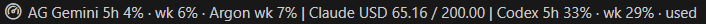
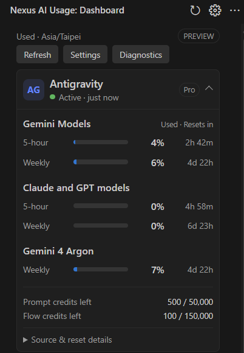
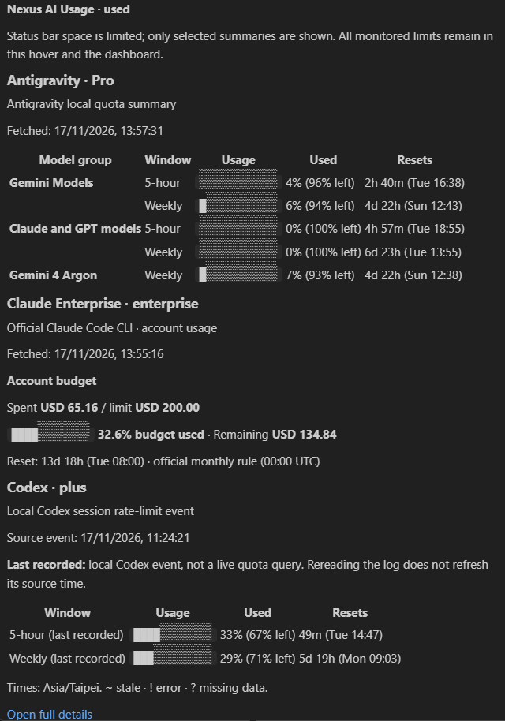
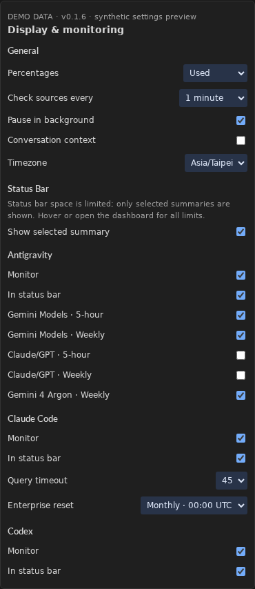

# Nexus AI Usage (Preview)

A local quota monitor for Antigravity, Claude personal subscription quotas,
Enterprise account spend, and Codex.
Derived from [Quota Nexus](https://github.com/praveen2git/quota-nexus), with Claude
usage-query code adapted from Claude Usage Ultra. See [LICENSE](LICENSE) and
[THIRD-PARTY-NOTICES.md](THIRD-PARTY-NOTICES.md).

This preview has a separate extension ID, commands, settings and cache:
`nexus-ai-usage-local.nexus-ai-usage`. It does not replace or migrate Quota Nexus.
It is unofficial and is not affiliated with Google, Anthropic or OpenAI.

## UI preview — 0.1.6

The status bar, dashboard and hover below are maintainer-provided screenshots from
Antigravity IDE on **2026-11-17**. Values are account-specific snapshots, not live
readings or fixed budgets. The settings preview is separately labelled synthetic
**DEMO DATA**; it does not represent a signed-in Pro / Max account test.

### Selected status bar summary



Gemini **5-hour / Weekly** and **Argon Weekly** are selected by default. Claude/GPT
can be added in settings; the complete limits remain in the hover and dashboard.
Status bar width is shared with the IDE and other extensions, so choose the
summaries that fit your window.

### Detailed dashboard

| Antigravity | Claude Enterprise and Codex |
| --- | --- |
|  |  |

Enterprise spending, remaining budget and the labelled monthly reset rule are
separate from conversation context. Codex **Last recorded** keeps the original
event time without treating normal idle time as a yellow warning; read failures
still warn.

<details>
<summary>Full hover: all monitored limits, including those omitted from the status bar</summary>



</details>

<details>
<summary>Choose status bar windows — synthetic settings preview</summary>



Use **Settings → Antigravity** to select individual windows. These choices affect
only the summary, not provider polling or the full dashboard.

</details>

See [preview provenance and UI highlights](https://github.com/peter821231/nexus-ai-usage/blob/main/docs/ui-previews.md) for image sources,
the changes illustrated and instructions to regenerate the synthetic settings view.

## Features

- **Antigravity:** Gemini Models 5-hour and weekly; Claude and GPT models 5-hour
  and weekly; Gemini 4 Argon weekly. Full group identity is preserved even when
  percentages and reset times happen to match.
- **Claude Pro / Max:** source-provided 5-hour, weekly and model-scoped quotas
  with their own resets. Subscription quotas stay primary in the status bar,
  expanded card and collapsed preview, even with extra usage enabled. Additional
  spending is a separate budget section; missing values stay **Unknown**.
- **Claude Enterprise:** actual account spend, source-provided limit, remaining amount and
  budget percentage through the installed official Claude Code CLI. The limit
  is never hard-coded to USD 200. The display describes account usage; it does
  not claim a separate Claude-Code-only bill.
- **Codex:** 5-hour and weekly rate-limit events from local session logs, with
  the event's original time. Reading a log again does not make its data newer.
- Compact AG / CC / CX provider cards with inline quota bars and reset countdowns;
  cards can collapse and retain their state after refresh or webview reload.
  Reduced header padding, row heights and section spacing keep more usage visible
  in the sidebar while retaining quota labels, resets and separate budget/context.
  Full source times and absolute resets remain in each card’s **Source & reset
  details** disclosure. Existing Antigravity credits and model labels are available
  without extra queries.
- The status bar hover includes compact usage charts and used/remaining values.
- Antigravity's status summary defaults to **Gemini Models 5-hour / Weekly** and
  independent **Gemini 4 Argon Weekly**. Five boolean choices let you include or
  omit each window; these affect only the summary, not the full hover or dashboard.
- One status bar summary and a detailed panel. Percentages default to **used**;
  the panel also shows **remaining**. Conversation context is an optional,
  separate detail section, off by default.
- Missing readings are **Unknown**. Failed queries retain the last successful
  reading and show an error. Stale readings stay visible with their source time.
  Passing a reset time never rewrites an observation to 0% or 100%.
- Absolute reset times, countdowns and timezone are explicit. For this verified
  Enterprise monthly plan, when the CLI omits a reset, the next UTC calendar-month
  boundary is calculated from the reading time and labelled **official monthly
  rule**. It is not represented as a reset timestamp returned by the CLI.

No account switching, sign-in flow, additional providers, cloud service,
telemetry, burn-rate prediction or notifications are enabled in this version.

## Install and compare

1. Keep your current Quota Nexus and Claude Usage Ultra installed.
2. Download `nexus-ai-usage-<version>.vsix` from [GitHub Releases](https://github.com/peter821231/nexus-ai-usage/releases) (or build locally with `npm run package` into `artifacts/`).
3. In the target IDE, use **Extensions: Install from VSIX…** and select the downloaded `.vsix` file.
4. For the checked Windows + WSL environment, install/run the preview in the WSL
   extension host, where the official Claude extension and the other sources
   were found. Run **Nexus AI Usage: Show Diagnostics** to check availability.
5. Open **Nexus AI Usage** in the Activity Bar. Compare its values and reset times
   with the providers' official usage views. A fresh query can still be subject
   to a provider cache or the monitor's query interval.
6. For the final single-monitor check, temporarily disable the original Nexus
   and Ultra without uninstalling them. Restore them if the preview does not
   pass comparison. Only remove them after the replacement is accepted.

The sources must be reachable from the extension host that runs this preview.
This version does not bridge Windows, WSL, SSH or container hosts. Windows and
macOS native execution are supported by source paths but have not been tested
on the user's account. VS Code core requirement is declared in `package.json`;
installation alone is not proof that all sources are available.

## Sources, credentials and freshness

| Provider | Source | Freshness |
|---|---|---|
| Antigravity | Local loopback quota summary; existing process discovery and local session token | Check about once a minute; summary queries are cached for two minutes. Mark stale after five minutes without a successful summary. Time is labelled **Fetched**, not a backend event timestamp. |
| Claude | Official `anthropic.claude-code` extension's bundled native CLI | Query about every five minutes; manual requests are at least a minute apart and respect failure backoff. Mark stale after ten minutes. Multiple windows in the same host share a query lease and cache. |
| Codex | Rate-limit events in local `~/.codex/sessions` logs | Check about once a minute; old events are labelled **Last recorded** in neutral styling, retaining their real timestamps and values. Read errors still warn. Other devices may have newer usage. |

The monitor does not read Claude credential files or request tokens/Cookies.
The official CLI owns authentication. It is queried with `initialize` and
`get_usage`, without sending a model prompt, in the extension's own storage
folder, with an empty strict MCP configuration and no session persistence.
The control protocol is internal and can change with CLI updates. Global CLI
settings and authentication still belong to the official tool.

Antigravity discovery does access its local session token in memory, and local
log parsing reads file tails to extract the needed events. It would be
incorrect to describe the extension as never touching sensitive local data.
Raw responses, credentials, conversation contents and account identifiers are
not written to monitor diagnostics, cache or fixtures. The shared Claude cache
contains only normalized usage fields and timestamps in extension storage.
The monitor does not bundle the official CLI.

Timeout, unavailable CLI, refused query, unsupported format, missing amount,
missing limit and unknown reset are distinct from a genuine zero. Money requires
known units and currency. Legacy `extra_usage` without an explicit currency and
scale is shown as unsupported, rather than assuming cents or USD. If the actual
CLI schema changes, check diagnostics and continue using the existing monitors
until the format is verified.

## Enterprise monthly reset

The [official consumption guide](https://support.claude.com/en/articles/14782391-claude-enterprise-consumption-guide)
says monthly spend caps reset at **00:00 UTC on the first of the month**. Confirmed
against an Enterprise account's personal Usage page (**08:00 GMT+8** in Asia/Taipei),
matching this rule.
This is independent of an invoice date or local midnight.

The default `claudeCode.enterpriseResetSchedule` is `monthlyUtc`, applying only
to valid Enterprise spend readings whose source does not report another period.
Set it to `unknown` for source-only behavior if a different account/plan does not
match this monthly rule. Other subscription plans are not assigned this reset.
A provider-supplied reset always takes precedence. The generated Admin API schema
also lists other periods, so this is not a claim that every Enterprise contract
has the same schedule. No Admin API key or new service is needed.

The derived reset belongs to the **reading's month**. An old November reading
still points to December 1 after that boundary passes and becomes stale/pending;
it does not silently advance to January or change spend to zero. A new source
query is needed to observe the next period's actual spend.

## Personal Claude subscriptions

The same official CLI query reads Pro / Max usage; no account switching or new
credentials are needed. Both the legacy `five_hour` / `seven_day*` response and
the newer `limits` list with model scope are supported. Source-provided rows with
missing or invalid percentages remain visible as **Unknown**, distinct from 0%.
Only returned model-specific windows are shown; the monitor does not invent a
model quota or a USD 200 budget for a personal subscription.
Missing core 5-hour / Weekly windows for a recognized Pro / Max plan are shown
as **Unknown**; model-specific windows are added only when the source reports them.

Personal subscription resets always come from the source. The Enterprise monthly
setting does not assign resets to personal quotas or extra spending. Optional
extra usage remains separate from subscription percentages and Context; an
unsupported money format does not prevent valid quota rows from displaying.

Pro / Max compatibility is covered by artificial protocol fixtures and browser
checks with extra usage absent, supported or unsupported. It has not yet been
compared with a signed-in Pro / Max account. These tests do not claim that every
CLI version or personal account exposes every window.

## Commands and settings

Commands: **Refresh Usage**, **Quick Settings**, **Open Settings**, **Toggle Used /
Remaining**, and **Show Diagnostics**, all under **Nexus AI Usage**.

Settings use only `nexusAiUsage.*`:

- `display.percentMode`: `used` or `left`.
- `display.timeZone`: `Asia/Taipei` (default) or `UTC`.
- `refresh.activeInterval`: 30 seconds, 1 minute, 2 minutes or 5 minutes.
- `refresh.pauseWhenUnfocused`: pause regular checks in the background.
- `context.show`: optional conversation-context section; off by default.
- `statusBar.show`, plus each provider's `enable` and `showInStatusBar`.
- Under `antigravity.statusBar.*`, `geminiFiveHour`, `geminiWeekly` and `argonWeekly`
  are on by default; `claudeGptFiveHour` and `claudeGptWeekly` are off by default.
- `claudeCode.timeoutSeconds`: 15, 30, 45 (default) or 60 seconds.
- `claudeCode.enterpriseResetSchedule`: `monthlyUtc` (verified monthly UTC rule)
  or `unknown` (source-only). Rule-derived dates are visibly labelled.

Status bar markers: `~` stale, `!` error/unsupported money, `?` missing quota.
Only providers included in the status bar affect its warning background. Hiding
every provider hides the item; the hover still offers full monitored details.
The Antigravity summary includes the selected windows by name, including Unknown
values; deselecting all five omits Antigravity from the bar. Its hover and panel
still include all monitored windows, even ones omitted from the status bar.

Status bar space is shared with the IDE and other extensions. Width, font/zoom
and the other items determine what fits; this extension does not claim a fixed
character maximum or silently truncate values. Choose the summaries you need.
The hover and dashboard settings explicitly explain that only a subset is shown.
See [0.1.6 status-bar choices](docs/status-bar-0.1.6.md) for the exact settings and
the distinction between recorded Codex data and read failures.

Codex **Last recorded** describes an old local event, not a successful new live
query. Its source time is never refreshed merely by reading the log. Age or an
elapsed reset alone does not turn the status item yellow; the elapsed reset still
shows pending in details and usage is never auto-zeroed. A Codex read error keeps
the last values, marks the error and still uses the warning background. Other
providers retain their existing missing/error/stale indications.

## Develop and verify

Use Node 22 and npm. All dependencies are development tools; the installed
extension has no npm runtime dependencies.

```sh
npm ci --ignore-scripts
npm run check
npm test
npx playwright install chromium --only-shell
npm run test:ui
npm run package
```

Chromium needs the platform's usual browser libraries. `test:ui` serves the actual
webview HTML/CSP, CSS and script on a temporary loopback port with a mocked VS
Code bridge and **artificial data**, not a logged-in browser profile. It checks
280/360/900-pixel widths, dark/light/forced-colors rendering, settings/refresh
messages, unknown values and safe text rendering. Demo screenshots are written
to ignored `artifacts/` and visibly labelled **DEMO DATA**.

The built VSIX is also in `artifacts/`. Packaging uses an allowlist of runtime
JavaScript, dashboard media, icons and notices. Agent documents, local credentials,
development tools, tests, reports and unrelated files stay outside the package.
Unused upstream account/history/forecast/notification helpers have been removed.
Build and test commands do not publish the extension to a marketplace. Pushing a
version tag (`v*`, matching `package.json` version) triggers the GitHub Actions
release workflow to verify checks, tests, UI tests, and attach the built `.vsix`
to a GitHub Release. Repository metadata points to this fork while original
upstream sources remain credited above.

The development-tool override for `minimatch` 11.0.1 addresses
[GHSA-g3hv-75wg-m249](https://github.com/advisories/GHSA-g3hv-75wg-m249).
It is not a runtime dependency. Package validation checks this override against
the actual VSIX contents. Dependabot tracks npm development tools and GitHub Actions.

## Repository map and review

- `src/`: extension host, source readers, usage normalization and status bar.
- `media/`: dashboard DOM and styles.
- `test/`: current runtime regression tests and synthetic protocol fixtures.
- `scripts/`: syntax, browser and local packaging checks.
- `docs/`: development notes ([development-notes.md](docs/development-notes.md)), status-bar reference, and review documentation.
- `images/`: inherited upstream reference screenshots, excluded from the VSIX.
- `artifacts/`: ignored local VSIX files and artificial preview output.

See [the security and code review](docs/review-2026-11-16.md) for scope, fixes,
dependency matching and remaining acceptance limits. Review outputs do not contain
credentials or raw provider responses.

Real-source integration was checked in WSL with Antigravity IDE 2.7.0 (VS Code
core 1.107.0) and official Claude Code extension 2.1.325. This does not substitute
for installing the VSIX in the IDE and comparing the current personal Usage page,
spend period and effective limit. No published marketplace release is implied.
