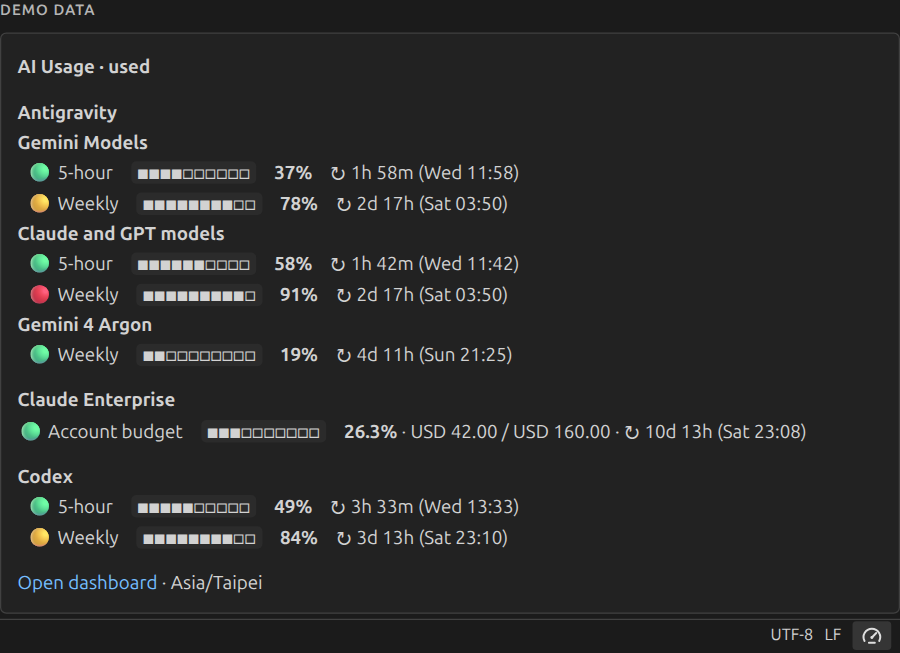
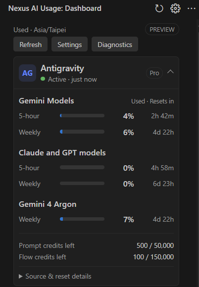
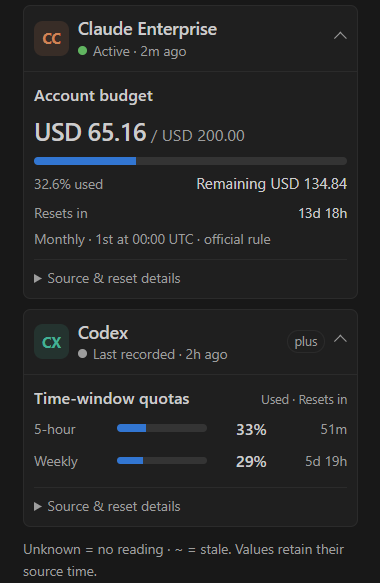
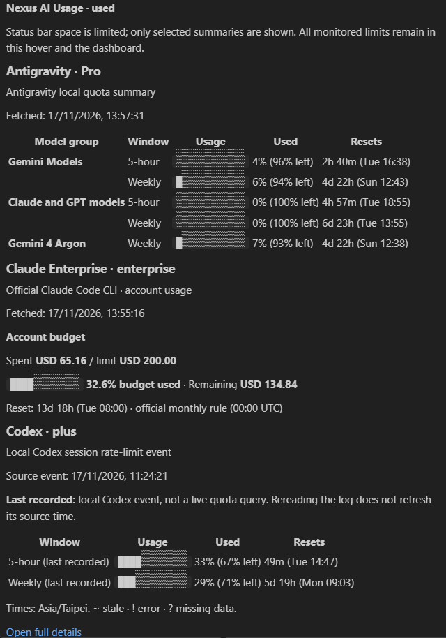
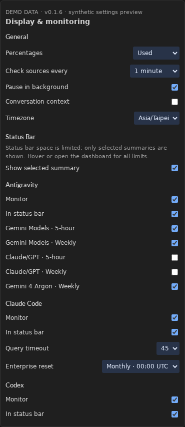

# AI Usage

[English](README.md) | **繁體中文（台灣）**

在本機監看 Antigravity、Claude 訂閱額度、Enterprise 帳戶支出及 Codex 用量的工具。
本專案衍生自 [Quota Nexus](https://github.com/praveen2git/quota-nexus)，Claude 用量查詢程式碼則改寫自 Claude Usage Ultra。
詳見 [LICENSE](LICENSE) 與 [THIRD-PARTY-NOTICES.md](THIRD-PARTY-NOTICES.md)。

此預覽版使用獨立的擴充套件 ID、命令、設定與快取：
`nexus-ai-usage-local.nexus-ai-usage`，不會取代 Quota Nexus 或移轉其資料。
這是非官方專案，與 Google、Anthropic 或 OpenAI 均無隸屬關係。

## 介面預覽 — 0.1.19

在 **設定 → 狀態列 → 精簡模式** 勾選後，狀態列只顯示一個額度儀表。
將滑鼠移到圖示上，可查看各群組的額度、燈號、放大的分段進度條和重設時間。
點一下圖示即可開啟儀表板。



上圖採用示範資料。維護者於 2026-11-18 在 IDE 的繁體中文介面確認放大的分段進度條與精簡模式。

## 舊版介面預覽 — 0.1.6

以下狀態列、儀表板與滑鼠懸停提示的截圖，由維護者於 **2026-11-17** 在 Antigravity IDE 中擷取。
數值是特定帳戶在當下的紀錄，並非即時讀數，也不代表固定預算。
設定預覽另外標示為合成的 **DEMO DATA（示範資料）**，不代表已登入 Pro / Max 帳戶進行測試。

### 自選狀態列摘要


預設選取 Gemini **5-hour / Weekly（5 小時／每週）** 及 **Argon Weekly（Argon 每週）**。
可在設定中加入 Claude/GPT；滑鼠懸停提示與儀表板仍會顯示完整額度。

### 詳細儀表板

| Antigravity | Claude Enterprise 與 Codex |
| --- | --- |
|  |  |

Enterprise 支出、剩餘預算與附有標示的每月重設規則，會與對話脈絡分開顯示。
Codex 的 **Last recorded（最近記錄）** 保留事件原始時間；一般閒置時間不會觸發黃色警示，讀取失敗仍會警示。

<details>
<summary>完整懸停提示：包含狀態列未顯示的所有監看額度</summary>



</details>

<details>
<summary>選擇狀態列顯示的額度週期 — 合成設定預覽</summary>



在 **Settings → Antigravity** 中選取個別額度週期。
這些選項僅影響摘要，不會改變服務提供者的定期查詢或完整儀表板。

</details>

圖片來源、畫面中的變更，以及重新產生合成設定預覽的方式，請參閱[預覽來源與介面重點](https://github.com/peter821231/nexus-ai-usage/blob/main/docs/ui-previews.md)。

## 介面語言

開啟 **快速設定 → 一般 → 語言**，可選擇 **跟隨編輯器**（預設）、
**English** 或 **繁體中文（台灣）**。儀表板、快速設定、狀態列、來源詳細資訊與
無障礙標籤會立即切換，方便使用英文編輯器、但偏好中文用量資訊的人。

命令名稱、編輯器原生設定頁與固定檢視名稱仍跟隨編輯器的顯示語言。
切換語言不會更動時區、用量數值與來源時間，也不會額外查詢供應商。
缺少翻譯時會使用英文。若想提供其他語系，請參考[翻譯貢獻指南](locales/README.md)，
使用工具產生範本後填寫譯文。

## 功能

- **Antigravity**：Gemini Models 的 5 小時及每週額度、Claude 與 GPT 模型的 5 小時及每週額度，以及 Gemini 4 Argon 的每週額度。即使用量百分比與重設時間相同，也會保留完整的群組識別資訊。
- **Claude Pro / Max 與 Team（合成資料測試）**：顯示來源提供的 5 小時、每週及個別模型額度，各自保有重設時間。即使啟用額外用量，狀態列、展開卡片及收合預覽仍以訂閱額度為主。額外支出放在獨立的預算區塊；缺少的數值維持 **Unknown（未知）**。
- **Claude Enterprise**：透過已安裝的官方 Claude Code CLI，取得實際帳戶支出、來源提供的上限、剩餘金額及預算使用百分比。上限不會寫死為 200 美元。畫面描述的是帳戶用量，不宣稱這是一份僅計算 Claude Code 的獨立帳單。
- **Codex**：向官方 Codex App Server 查詢帳戶額度與重設時間。本機工作階段記錄可供備援，並保留事件的原始時間。
- 精簡的 AG / CC / CX 服務卡片，內含額度長條圖與重設倒數；卡片可收合，並在重新整理或重新載入網頁檢視後保留收合狀態。縮小標頭留白、列高與區塊間距，讓側邊欄能顯示更多用量，同時保留額度標籤、重設資訊，以及分開呈現的預算與對話脈絡。完整來源時間與確切重設時間，仍可在各卡片的 **Source & reset details（來源與重設詳細資訊）** 中展開檢視。模型標籤與 Antigravity 內部點數欄位無須額外查詢即可讀取；點數欄位的意義與尺度尚未和官方用量介面核對，不能視為已確認的可用額度。
- 狀態列的懸停提示提供精簡用量圖表，以及已用／剩餘數值。
- Antigravity 狀態摘要預設顯示 **Gemini Models 5-hour / Weekly** 及獨立的 **Gemini 4 Argon Weekly**。五個布林選項可分別選擇是否顯示各週期；僅影響摘要，不影響完整懸停提示或儀表板。
- 提供單一狀態列摘要與詳細面板。百分比預設顯示**已用**，面板也會顯示**剩餘**。對話脈絡是可選的獨立詳細資訊區塊，預設關閉。
- 缺少讀數時顯示 **Unknown**。查詢失敗會保留最近一次成功的讀數並顯示錯誤。過時讀數仍會顯示，並附上來源時間。超過重設時間不會自動將觀測值改成 0% 或 100%。
- 明確顯示確切重設時間、倒數與時區。對已驗證的 Enterprise 月方案，若 CLI 未提供重設時間，會依讀數時間計算下一個 UTC 曆月的起點，並標示為 **official monthly rule（官方每月規則）**，不會將其呈現為 CLI 回傳的重設時間戳記。

此版本未啟用帳戶切換、登入流程、其他服務提供者、雲端服務、遙測、用量消耗速度預測或通知。

## 使用條件與限制

請將 AI Usage 安裝在你使用各家官方整合的 IDE。資料來源必須能由同一個擴充套件主機存取。Windows、WSL、SSH 與容器各自有獨立的檔案、程序和登入狀態。例如，用 WSL 開啟的工作區需要在 WSL 主機設定官方整合並產生用量資料。IDE 須支援 VS Code 擴充套件並符合 [`package.json`](package.json) 的版本範圍。

| 服務 | AI Usage 所在的擴充套件主機需要具備的條件 |
| --- | --- |
| Antigravity | 啟動並登入 Antigravity IDE 或官方編輯器整合。AI Usage 需要連到可回傳額度的 Antigravity 語言伺服器。 |
| Claude | 在該 IDE 主機安裝官方 Claude Code 擴充套件（`anthropic.claude-code`），並登入要監看的 Claude 帳戶或 Team 工作區。僅登入 Claude Desktop 的環境不在支援範圍。 |
| Codex | 在同一主機以官方 Codex 擴充套件或 CLI 登入 ChatGPT。AI Usage 會尋找隨擴充套件附帶或位於主機 `PATH` 上的 Codex 執行檔。工作階段備援讀取預設的 `~/.codex/sessions`。 |

## 安裝與比對

1. 從 [GitHub Releases](https://github.com/peter821231/nexus-ai-usage/releases) 下載 `nexus-ai-usage-<version>.vsix`，或在本機執行 `npm run package`，將套件建置到 `artifacts/`。
2. 在目標 IDE 執行 **Extensions: Install from VSIX…**，選取下載的檔案。
3. 在活動列開啟 **AI Usage**，執行 **Show Diagnostics（顯示診斷資訊）** 檢查本機來源。
4. 將數值與重設時間和各服務的官方用量頁面比對。服務提供者的快取與查詢間隔可能延遲新讀數。

## 資料來源、驗證資訊與更新時效

| 服務 | 來源 | 更新時效 |
| --- | --- | --- |
| Antigravity | 本機回送位址上的額度摘要；沿用既有的程序探索方式與本機工作階段權杖 | 約每分鐘檢查一次；摘要查詢快取兩分鐘。超過五分鐘未成功取得摘要即標示為過時。時間標示為 **Fetched（擷取時間）**，並非後端事件時間戳記。 |
| Claude | 官方 Claude Code 擴充套件內附的 CLI，或同一主機的官方原生 CLI 備援 | 約每五分鐘查詢一次。手動查詢至少間隔一分鐘，失敗後會逐步延長重試間隔。讀數超過十分鐘會標示為過時。同一主機的多個視窗共用查詢租約與快取。 |
| Codex | 官方 Codex App Server，以本機工作階段事件備援 | 按刷新間隔（預設 1 分鐘）及手動重新整理時查詢。帳戶查詢成功會顯示 **Fetched（擷取時間）**，較舊的工作階段事件以 **Last recorded（最近記錄）** 顯示原始時間及數值。 |

若 Claude Code 擴充套件內附的 CLI 無法啟動，AI Usage 會嘗試同一主機的官方原生安裝位置（macOS／Linux 為 `~/.local/bin/claude`，Windows 為 `%USERPROFILE%\.local\bin\claude.exe`）。**Diagnostics（診斷）**會顯示兩處是否有執行檔。[Claude Code 官方安裝疑難排解](https://code.claude.com/docs/en/troubleshoot-install)

監看工具不會讀取 Claude 憑證檔案，也不會要求提供權杖或 Cookie。
身分驗證由官方 CLI 處理。工具會在擴充套件自己的儲存資料夾中，使用 `initialize` 與 `get_usage` 查詢，
不傳送模型提示詞，並使用空白的嚴格 MCP 設定，也不儲存工作階段。
這是內部控制通訊協定，可能隨 CLI 更新而改變。全域 CLI 設定與身分驗證仍由官方工具管理。

AI Usage 透過本機標準輸入與輸出向 Codex 呼叫 `account/rateLimits/read`。
登入由官方執行檔處理，查詢不需開啟對話或送出模型請求。插件只保留顯示所需的額度欄位。
請參閱 [Codex App Server 文件](https://learn.chatgpt.com/docs/app-server#6-rate-limits-chatgpt)。
Windows 需要使用擴充套件內附的執行檔，或位於 `PATH` 上的 `codex.exe`。
使用工作階段紀錄備援時，診斷資訊仍會顯示 App Server 查詢錯誤。

Antigravity 程序探索會存取記憶體中的本機工作階段權杖；
本機記錄解析則會讀取檔案尾端，擷取所需事件。因此，不能宣稱此擴充套件完全不會接觸本機敏感資料。
原始回應、憑證、對話內容與帳戶識別資訊，不會寫入監看工具的診斷資訊、快取或測試資料。
共用 Claude 快取只會將正規化後的用量欄位與時間戳記儲存在擴充套件儲存空間中。
監看工具本身不附帶官方 CLI。

逾時、CLI 無法使用、查詢遭拒、不支援的格式、缺少金額、缺少上限與重設時間未知，都與真正的零值不同。
金額必須具有已知單位與幣別。舊版 `extra_usage` 若未明確提供幣別與換算比例，
會顯示為不支援，不會自行假設單位為美分或美元。
若實際 CLI 資料結構改變，請檢查診斷資訊，並在格式驗證完成前繼續使用既有監看工具。

## Enterprise 每月重設

[官方用量計費指南](https://support.claude.com/en/articles/14782391-claude-enterprise-consumption-guide)
指出，每月支出上限會在**每月一日 00:00 UTC** 重設。
此規則已與 Enterprise 帳戶的個人 Usage 頁面確認一致，在 Asia/Taipei 為 **08:00 GMT+8**。
這與發票日期或當地午夜無關。

`claudeCode.enterpriseResetSchedule` 預設為 `monthlyUtc`，僅套用於有效的 Enterprise 支出讀數，且來源未回報其他週期時才會使用。
若其他帳戶或方案不符合此每月規則，可設為 `unknown`，僅採用來源提供的資訊。
此設定不會替其他訂閱方案指定重設時間；服務提供者回傳的重設時間一律優先。
自動產生的 Admin API 資料結構定義也列有其他週期，因此這不代表每份 Enterprise 合約都有相同時程。
無須 Admin API 金鑰或新服務。

推算的重設時間屬於**讀數所在的月份**。
例如，十一月的舊讀數在十二月一日過後，仍指向十二月一日，並標示為過時／待更新；
不會默默推進到一月，也不會把支出改成零。必須重新查詢來源，才能取得下一個週期的實際支出。

## Claude Pro / Max 與 Team 訂閱

監看工具會使用官方 Claude Code CLI 目前登入的帳戶。
解析器支援 `five_hour` / `seven_day*`、`limits`，以及 `model_scoped` 清單中的個別模型每週額度。CLI 回報獨立的 Fable 每週額度時，儀表板會在獨立區塊顯示其百分比與重設時間，收合卡片與狀態列也會顯示 Fable。
來源提供的資料列若缺少百分比或百分比無效，仍會顯示為 **Unknown**，與 0% 區分。
僅顯示來源回傳的個別模型額度週期，不會替個人訂閱虛構模型額度或 200 美元預算。
若辨識為 Pro / Max 或 Team 方案，但缺少主要的 5-hour / Weekly 額度，會顯示為 **Unknown**；
個別模型週期則只有在來源回報時才加入。

個人訂閱的重設時間一律來自來源。Enterprise 每月設定不會替個人額度或額外支出指定重設時間。
可選的額外用量會與訂閱百分比及 Context（對話脈絡）分開呈現；
即使金額格式不受支援，仍會顯示有效的額度資料列。

合成回應測試涵蓋 Pro / Max 的額外用量，以及 Team 的工作階段、每週所有模型和每週 Fable 額度。
Pro / Max 與 Team 仍待使用已登入的帳戶實際比對。

## 命令與設定

以下命令皆位於 **AI Usage** 類別下：

- **Refresh Usage**：重新整理用量。
- **Quick Settings**：快速設定。
- **Open Settings**：開啟設定。
- **Toggle Used / Remaining**：切換已用／剩餘百分比。
- **Show Diagnostics**：顯示診斷資訊。

所有設定皆使用 `nexusAiUsage.*` 字首：

- `display.percentMode`：`used`（已用）或 `left`（剩餘）。
- `display.timeZone`：`Asia/Taipei`（預設）或 `UTC`。
- `display.language`：`auto`（跟隨編輯器）、`en` 或 `zh-TW`。
- `refresh.activeInterval`：30 秒、1 分鐘、2 分鐘或 5 分鐘。
- `refresh.pauseWhenUnfocused`：在背景時暫停定期檢查。
- `context.show`：可選的對話脈絡區塊，預設關閉。
- `statusBar.show`，以及各服務的 `enable` 與 `showInStatusBar`。未設定 `showInStatusBar` 時，讀到額度或支出資料後，該服務會自動顯示。手動設定優先。
- `statusBar.compact`：只顯示額度儀表圖示，預設關閉。
- `antigravity.statusBar.*` 下的 `geminiFiveHour`、`geminiWeekly`、`argonWeekly` 預設開啟；`claudeGptFiveHour`、`claudeGptWeekly` 預設關閉。
- `claudeCode.timeoutSeconds`：15、30、45（預設）或 60 秒。
- `claudeCode.enterpriseResetSchedule`：`monthlyUtc`（已驗證的每月 UTC 規則）或 `unknown`（僅採用來源）。依規則推算的日期會明確標示。

狀態列標記：`~` 代表過時、`!` 代表錯誤／不支援的金額格式、`?` 代表缺少額度。
只有納入狀態列的服務會影響警示背景。隱藏所有服務時，狀態列項目也會隱藏；項目的懸停提示提供完整監看資訊。
Antigravity 摘要會顯示所選週期名稱，包含數值為 Unknown 的項目；取消全部五個選項後，狀態列便不會顯示 Antigravity。
懸停提示與面板仍保留所有監看的週期，包括狀態列未選取的項目。

狀態列空間由 IDE 與其他擴充套件共用，能顯示多少內容取決於寬度、字型／縮放比例及其他項目。
此擴充套件不宣稱有固定的字元數上限，也不會默默截斷數值。請選擇需要的摘要。
懸停提示會為每筆額度顯示燈號、分段進度條、百分比和重設時間。已使用 75% 時轉黃、90% 時轉紅，未知讀值標為白色。
完整設定及 Codex 舊記錄與讀取失敗的差異，請參閱 [0.1.6 狀態列選項（英文）](docs/status-bar-0.1.6.md)。

Codex 的 **Last recorded** 描述的是本機舊事件，不代表剛成功完成即時查詢。
僅重新讀取記錄檔不會更新來源時間。資料較舊或超過重設時間，本身不會讓狀態列項目變成黃色；
已過的重設時間仍會在詳細資訊中顯示待更新，用量也不會自動歸零。
Codex 讀取錯誤會保留最後數值、標示錯誤，並使用警示背景。
其他服務維持既有的缺漏、錯誤與過時提示方式。

## 開發與驗證

請使用 Node 22 與 npm。所有相依套件皆為開發工具；安裝後的擴充套件沒有 npm 執行階段相依套件。

```sh
npm ci --ignore-scripts
npm run check
npm test
npx playwright install chromium --only-shell
npm run test:ui
npm run package
```

Chromium 需要作業系統一般瀏覽器所需的函式庫。
`test:ui` 會在暫時的本機回送連接埠提供實際網頁檢視的 HTML/CSP、CSS 與指令碼，
搭配模擬的 VS Code 橋接與**合成資料**，不使用已登入的瀏覽器設定檔。
檢查範圍包含 280／360／900 像素寬度、深色／淺色／強制色彩模式的呈現、設定／重新整理訊息、未知數值，以及安全的文字呈現。
示範截圖會寫入已由版本控制忽略的 `artifacts/`，並明確標示 **DEMO DATA**。

建置完成的 VSIX 也位於 `artifacts/`。
封裝採用允許清單，只納入執行階段 JavaScript、儀表板資源、圖示與說明文件。
代理程式文件、本機憑證、開發工具、測試、報告及無關檔案不會納入套件。
未使用的上游帳戶、歷程、預測與通知輔助程式已移除。
建置與測試命令不會將擴充套件發布到市集。
推送版本標籤（`v*`，須與 `package.json` 版本一致）會觸發 GitHub Actions 發行流程，
執行檢查、測試與介面測試，並將建置的 `.vsix` 附加至 GitHub Release。
儲存庫中繼資料指向此分支專案，原始上游來源仍列於前方致謝。

開發工具的 `minimatch` 11.0.1 版本覆寫用於修正
[GHSA-g3hv-75wg-m249](https://github.com/advisories/GHSA-g3hv-75wg-m249)，它不是執行階段相依套件。
套件驗證會檢查實際 VSIX 內容是否符合此覆寫設定。
Dependabot 會追蹤 npm 開發工具與 GitHub Actions。

## 儲存庫導覽與審查

- `src/`：擴充套件主機、資料來源讀取、用量正規化與狀態列。
- `media/`：儀表板 DOM 與樣式。
- `test/`：目前的執行階段回歸測試與合成通訊協定測試資料。
- `scripts/`：語法、瀏覽器與本機封裝檢查。
- `docs/`：開發筆記（[development-notes.md](docs/development-notes.md)）、狀態列參考及審查文件，內容為英文。
- `images/`：沿用的上游參考截圖，不會納入 VSIX。
- `artifacts/`：已由版本控制忽略的本機 VSIX 檔案與合成預覽輸出。

範圍、修正、相依套件比對及尚待驗收的限制，請參閱[安全與程式碼審查（英文）](docs/review-2026-11-16.md)。
審查輸出不包含憑證或服務提供者的原始回應。

實際來源整合已在 WSL 環境中，以 Antigravity IDE 2.7.0（VS Code 核心 1.107.0）
與官方 Claude Code 擴充套件 2.1.325 檢查。
這不能取代將 VSIX 安裝到 IDE 後，與目前的個人 Usage 頁面、支出週期及有效上限進行比對。
此說明不代表已在擴充套件市集發布。
