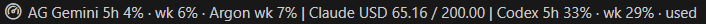
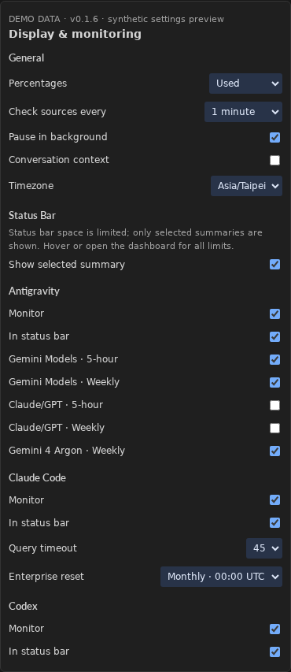

# 0.1.6 UI 預覽與來源

這組圖片展示目前版本的實際介面，存放於有版本控制的 `docs/images/`。它們是文件資產，不是 `artifacts` 的暫存輸出；`artifacts` 仍只保留最新版 VSIX。

## 實機截圖

以下四張由維護者於 2026-11-17 提供，來自 Antigravity IDE 的 0.1.6 實際畫面。檔案原樣複製，沒有裁切、重繪或改動額度數字，也沒有記錄來源電腦路徑。已檢查沒有 PNG 文字或 EXIF metadata。畫面上的用量與金額只代表截圖當時的帳號，不是其他使用者的預設額度，也不是持續更新的即時資料。

| 圖片 | 展示重點 |
| --- | --- |
| [狀態列](images/v0.1.6-status-bar.png) | Gemini 5h／wk、獨立 Argon wk、Enterprise 已花／上限、Codex 5h／wk。 |
| [Antigravity 詳細面板](images/v0.1.6-antigravity.png) | Gemini、Claude/GPT、Argon 完整群組；摘要省略的時間窗仍在面板。 |
| [Claude Enterprise 與 Codex 面板](images/v0.1.6-claude-codex.png) | 帳號支出、剩餘與官方月度規則標示；Codex 中性的 Last recorded。 |
| [完整 hover](images/v0.1.6-hover.png) | 全部額度進度條、來源時間、重置時間及明細，不受狀態列選項刪減。 |



## 這個版本應注意的介面差異

- **狀態列改為所選摘要**：預設 Gemini Models 5 小時／每週，加 Gemini 4 Argon 每週；可逐項選回 Claude/GPT。不再替每個群組僅挑一個最高使用率時間窗。
- **Argon 保留獨立名稱**：不和 Gemini Models 合併；一般 Gemini 與 Argon 即使比例相同，也仍是不同額度。
- **Enterprise 金額獨立呈現**：讀取來源提供的支出與上限，顯示剩餘；範例中的 USD 200 不是寫死的套件設定。畫面也清楚標示月度重置是依官方規則計算。
- **Codex 舊事件採中性提示**：Last recorded 是最後一筆本機紀錄；單純閒置不讓整條狀態列變黃。真正讀取失敗仍有錯誤與警告。
- **完整資料保留**：摘要的取捨不會刪掉 hover 或詳細面板的資訊；Context 是另外可開啟的區段，不拿來代表支出或額度比例。

這些說明展示本次客製的行為，不宣稱原版 Nexus 沒有 Argon 詳細額度，也不以此證明其他候選套件已經實測。

## 設定頁模擬預覽

下面是目前實際 webview HTML／CSS／JavaScript 在隔離瀏覽器中，以人工資料與預設設定呈現的畫面。圖片內含 **DEMO DATA** 標籤；它不是維護者的實機截圖，也不是 Pro／Max 帳號驗收。



開發環境已具備 Node、開發依賴、Playwright Chromium 及其系統程式庫時，可執行：

```sh
npm run test:ui -- --docs
```

這會跑既有人工 dashboard 驗證，並額外在 `artifacts/documentation-status-settings.png` 產生設定區塊預覽。圖片直接由 DOM 擷取，DEMO 標籤只加入測試畫面，不改動安裝後的產品 UI。人工圖片確認後，才手動更新對應的有版本檔名；不要拿模擬圖替換以上實機圖片。

## 文件與封裝

README 使用相對路徑，GitHub 與本機 Markdown 閱讀器均可開啟這組圖片。`.vscodeignore` 只額外允許這五個明確檔名，讓後續建置的 VSIX README 也能引用它們；其他文件、原始驗證資料與本機檔案仍不在封裝清單。

這次是文件與開發預覽工具更新，未修改監控執行期或套件版本，也不重建／替換已交付的 0.1.6 安裝檔。設定預覽、圖片連結、PNG metadata 與暫存封裝均另作驗證；既有的真實 Pro／Max 及原生平台驗收限制保持不變。
